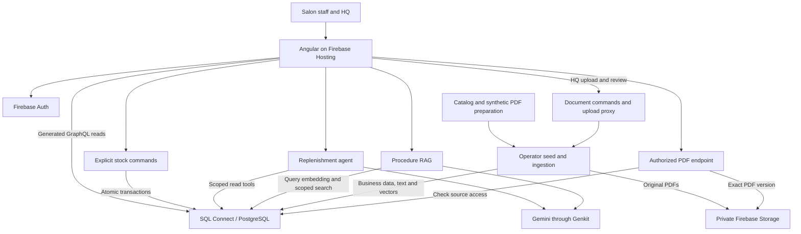

# Spec: BarberHQ — master project specification

> Updated 8 October 2026: the implemented [whole-request/settings contract](../../docs/implementation/shared-contracts.md) and [increment 2b handoff](../../docs/implementation/handoffs/increment-2b.md) supersede earlier single-product, per-row submission and public-threshold descriptions. RAG/AI remain future phases.

> Build a small business application that demonstrates measurable salon replenishment and evidence-based procedure guidance in a 20-minute DevFest presentation.

## Background

**Planning only · updated 29 September 2026.** BarberHQ is a demo for the real Not Bad Stuff cosmetics brand and the user-confirmed salons **Legnicka, Łódzka and Zakładowa**. Product facts come from six public product pages; stock, delivery scenarios and internal procedures are fictional demo data.

The presentation is **“My Barber Shipped While I Debated Architecture: Agentic AI in minutes with Firebase.”** Its central message is that understanding a business problem produces useful software, while engineering makes its behavior reliable and operable. The application should make that message visible through two small, complete workflows. It is not a production rollout or a claim that inaccessible company procedures have been reproduced.

The user approved the expanded Claude Design scope: multi-product drafts that create one request containing all items, an HQ-managed PDF library, a low-stock indicator and cited-region highlighting. The [approved design extensions](approved-design-extensions.md) define their behavior and phase ownership.

This is the project entry point. It describes the whole and connects the detailed specifications; agents should load only the details relevant to their assigned phase.

## Requirements

### 1. Business outcomes and users

**Replenishment:** salon staff ask for two additional Pomada Matowa 100 ml units. The assistant resolves the product and checks live data; staff submit the request. HQ approves and dispatches, then Legnicka confirms full intact receipt. The result is requested **2**, dispatched **2**, received **2**; HQ on-hand stock changes **18 → 16**, Legnicka **2 → 4**, and final in-transit stock is zero. Approval reserves stock; dispatch and receipt record the physical movements.

**Procedure guidance:** Zakładowa asks what to do about a damaged product in a separate fictional delivery, `DEMO-DAMAGE-01`. The assistant finds the applicable procedure, explains supported steps and links the exact PDF version/page. It does not submit a damage report, promise a replacement or change inventory. Missing evidence produces an explicit insufficient-information response.

Salon staff access their assigned salons. HQ manages its business's request queue. HQ also manages the document library: upload, review, replace and delete versions. The presenter/operator configures resources and loads/resets demo fixtures outside the staff UI.

### 2. Pieces and their relationships

| Piece | Responsibility | Depends on / supplies |
|---|---|---|
| Angular application | Shared multi-product draft, HQ queue, request timeline, document library, procedure questions and highlighted PDF viewer | Uses Auth, generated GraphQL reads and backend functions |
| Firebase Authentication | Identifies signed-in users | SQL membership determines business, role and salon permissions |
| SQL Connect / PostgreSQL | Products, inventory, requests, transfers, audit receipts, membership and indexed knowledge | Deployed GraphQL operations and generated SDKs connect the app/server to data |
| Deterministic backend commands | Validate and atomically submit, approve, dispatch and receive | Enforce trusted quantities, permissions, state and retry safety |
| Replenishment agent | Interprets a request and selects bounded read tools | Reads live structured data; returns a proposal to the ordinary submission workflow |
| RAG flow | Finds relevant document passages and explains them with citations | Query embedding, authorized vector retrieval and Gemini; no stock mutation tools |
| Private Firebase Storage | Retains immutable original PDFs | Ingestion reads them; an authorized backend endpoint serves cited originals |
| Preparation and ingestion tools | Produce fixtures/PDFs, seed SQL, extract/review/chunk/embed documents | Initial operator preload plus HQ-triggered reviewed imports; create evidence for both workflows |
| Hosting and operational setup | Serve the Angular SPA and configure resources, access and limits | Presenter guide plus backend/deployment phases |

AI flows and commands run on the server. The browser never connects directly to PostgreSQL. The agent helps prepare a business action; explicit user actions and deterministic code commit it.

### 3. Where data lives and why RAG exists

- **Repository:** dated product snapshot, synthetic procedure authoring Markdown, preparation manifests and evaluation cases. Evaluation answers are excluded from the indexed corpus.
- **Firebase Auth:** user identities and authentication credentials.
- **PostgreSQL:** structured business records, access scope, document metadata, readable page/chunk text and embedding vectors. **pgvector** provides vector storage/search within this database.
- **Firebase Storage:** the immutable source PDFs staff can open to verify an answer.
- **Local derived artifacts:** PDF-extracted Markdown and physical-page maps used to inspect and reproduce ingestion.

Initial preparation produces five PDFs: three current synthetic procedures, one retired procedure used to test filtering, and one unofficial product guide based on public product facts. Four versions are initially eligible for current retrieval; later HQ publication/deletion changes the corpus. Product facts and invented policies retain distinct provenance and visible labels.

The knowledge path is **PDF → extracted Markdown with page/geometry map → reviewed chunks → embeddings in PostgreSQL**. At question time, an embedding locates relevant authorized chunks; Gemini receives their readable text and returns cited guidance. RAG helps staff find procedures written in documents. Exact stock quantities come from structured queries and transactions.

### 4. Implementation phases and integration points

**Execution sequence update, 29 September:** the user approved delivery in five small working increments. The [incremental delivery design](../../docs/superpowers/specs/2026-09-29-barberhq-delivery-design.md), accepted for planning, owns that sequence and maps it onto the requirement packages below. First deploy login and real inventory; then complete manual replenishment, document processing/library, AI flows and rehearsal. Phase numbers remain coverage identifiers, not whole-layer scheduling gates. All existing acceptance requirements remain binding. The [execution index](../../docs/superpowers/plans/2026-09-29-barberhq-execution-index.md) links the detailed plans awaiting review and method selection.

| Phase specification | Produces | How it connects to the next pieces |
|---|---|---|
| [0 — Presenter setup](../../docs/06-firebase-setup-guide.md) | Project, Auth users, Storage, SQL Connect and model settings | Enables deployed backend and ingestion; can accompany local data preparation |
| [1 — Data and PDFs](phase-01-data-and-pdfs.md) | Validated product/stock fixtures and reviewed PDF manifest | Inputs to phase 3 |
| [2 — Firebase/GraphQL backend](phase-02-firebase-graphql-backend.md) | Schema, generated interfaces, scoped reads, stock/document commands and upload contract | Contract for ingestion, Angular and AI flows |
| [3 — Seed and ingest](phase-03-seed-and-ingest.md) | Populated data, private PDFs, reusable ingestion worker and searchable chunks with geometry | Supplies actual records/evidence for phases 4–6 |
| [4 — Angular app](phase-04-angular-app.md) | Manual batch workflow, HQ library, low-stock UI and highlighted source viewer | UI and proven workflow extended by phases 5/6 |
| [5 — Replenishment agent](phase-05-replenishment-agent.md) | Multi-product natural-language draft preparation | Hands off to phase 4's explicit submission flow |
| [6 — RAG](phase-06-rag.md) | Grounded procedure answers and source cards | Queries phase 3's corpus and opens phase 4's viewer; independent of phase 5 |
| [7 — Demo readiness](phase-07-demo-readiness.md) | Deployed checks, repeatable reset and timed rehearsal | Verifies the integrated result and aligns presentation materials |

The manual workflow must work before AI is added. A phase is complete only when its acceptance checks pass and its handoff report identifies outputs and evidence. See the [execution index](../../docs/implementation/README.md) for dependencies, context packs and the reusable agent prompt.

### 5. Confirmed deployment

Deploy the Angular browser build to **classic Firebase Hosting**. Phase 4 implements build-time public configuration, SPA routes and Hosting settings. Phase 7 verifies a preview, promotes the tested release to the live site and demonstrates frontend rollback. Functions, SQL Connect and private Storage deploy separately; Hosting never resets inventory or runs document ingestion. App Hosting and SSR are outside the selected design. The [deployment specification](firebase-hosting-deployment.md) owns the exact requirements.

### 6. Document map and change ownership

| Document | Owns |
|---|---|
| This master specification | Purpose, scope, relationships and whole-project success |
| [Detailed application requirements](barberhq-replenishment-assistant.md) | User behavior, business rules, edge cases and product acceptance |
| [Approved design extensions](approved-design-extensions.md) | Batch semantics, document administration, low-stock setting and PDF geometry |
| [Shared contracts](../../docs/implementation/shared-contracts.md) | Cross-phase names, states, data boundaries and invariant quantities |
| [Architectural design](../../docs/05-architecture-how.md) | Execution flows, transactions, authorization and PDF/RAG mechanics |
| [Hosting deployment specification](firebase-hosting-deployment.md) | Cross-phase frontend build, configuration, release and rollback |
| [UI views and states](../../docs/design/views-and-states.md) | Screen inventory, role/state variants and Claude Design handoff; Angular Material plus domain components |
| Individual phase specifications above | Bounded implementation tasks, outputs and verification |
| [Research](../../docs/01-research-and-recommendation.md) | Technical feasibility, sources and alternatives |
| [Slide outline](../../docs/02-slide-outline.md) and [runbook](../../docs/03-demo-runbook.md) | Presentation narrative and stage execution |

A fresh agent starts here, then reads shared contracts, its assigned phase and relevant prerequisite reports. Detailed requirements/design are consulted for the sections the phase names. Do not load all phase specs or the full conversation by default.

Do not silently resolve contradictions by choosing whichever document is convenient. Preserve the agreed business outcomes, update the owning document and affected contracts/specs together, and record a material change in the phase handoff.

## Affected Files

| File | Change Type | Description |
|---|---|---|
| `web/` | Future create | Angular UI and generated read SDK consumer |
| `functions/` | Future create | Commands, AI flows, authorization and PDF serving |
| `dataconnect/` | Future create | Schema, connectors and SDK configuration |
| `scripts/` and `data/` | Future create | Preparation, seed/reset, ingestion and evaluation |
| `firebase.json` and `storage.rules` | Future create | Deployment configuration and private file access |
| `docs/implementation/handoffs/` | Future create | Evidence written when each phase is performed |

## Existing Patterns to Reuse

- Reuse the [six-product catalog](../../docs/not-bad-stuff-products.json) and [synthetic procedure sources](../../docs/synthetic-knowledge/README.md). Firecrawl or Chrome may refresh product facts during preparation; crawling is not an app dependency.
- Reuse the same manual stock commands for AI-prepared and manually entered requests.
- Reuse the same authorized PDF viewer for all document citations.
- Reuse Firebase services and generated interfaces; no application implementation exists yet.

## Constraints

One Angular SPA, one small backend codebase, one SQL database with pgvector and private file storage. SQL Connect is the implementation baseline; Firestore Vector remains a researched alternative requiring an explicit design change.

No autonomous stock writes, production scheduling, packaging/labels, payments, carrier integration, damage claims, partial-receipt resolution, OCR or PDF content editing. Model failures must leave the manual workflow usable. Retired, incomplete or unauthorized documents must never enter answer context.

Real names/products do not make fictional policies official. Keep synthetic procedures visibly labeled and factual product summaries marked as unofficial compilations. Do not claim measured savings or production readiness from a small demo.

## Open Questions

No additional business decision blocks specification handoff. Project settings and identities come from the presenter guide. Implementation must verify compatible package/model versions, regions, transactional expressions and retrieval thresholds. English is the default corpus language; Polish stage prompts depend on evaluation. A real pilot requires owner-approved procedures and validated operational rules.

## Acceptance Criteria

- [ ] The two-unit workflow completes with HQ16, Legnicka4 and zero in transit; duplicates and concurrent actions do not corrupt stock.
- [ ] All acceptance checks in the approved design extensions pass across the owning phases.
- [ ] Manual and natural-language request preparation converge on the same validated explicit commands.
- [ ] Damaged-delivery guidance cites current, authorized PDF evidence and produces no stock/request changes.
- [ ] Unsupported questions abstain; source links open the correct immutable version, physical page and highlighted passage.
- [ ] Access scope holds across GraphQL, commands, AI retrieval and PDF serving.
- [ ] Preparation/ingestion are reproducible and reset permits repeated rehearsals without losing published knowledge.
- [ ] Both scenarios fit the six-minute demo within the 20-minute talk, with verified behavior reflected in slide Markdown and the runbook.
- [ ] All phase reports distinguish completed verification from remaining limitations; no planning artifact is presented as implemented functionality.
