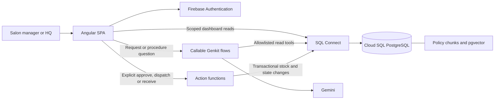

# Demo recommendation and technical feasibility

Research date: 22 September 2026. Status: replenishment candidate confirmed by the presenter; technical design remains a proposal, not an implementation or benchmark.

## Recommendation

**BarberHQ — two units requested and received; the right instructions when a delivery is damaged.**

The confirmed demo has two independent use cases. First, Legnicka requests two Pomada Matowa units. HQ approves and dispatches, then the salon confirms intact receipt: HQ 18 → 16, Legnicka 2 → 4. Second, a separate damaged delivery at Zakładowa triggers read-only retrieval of instructions with citations. It does not modify the completed transfer.

Replenishment provides a measurable business action. RAG helps staff find operating knowledge without searching documents or interrupting HQ. The presenter reports that many real procedures exist but cannot provide them, so the [synthetic corpus](synthetic-knowledge/README.md) explicitly stands in for them. No actual company policy is claimed.

The real brand is Not Bad Stuff and salons are Legnicka, Łódzka and Zakładowa. See [real catalog sources](04-not-bad-stuff-catalog.md). Inventory and procedures are demo fixtures. Individual-unit transfers supersede the earlier six-unit-pack/production-shortage proposal.

## Candidate comparison

Historical candidate comparison; the confirmed scope above supersedes the initial ranking. Scores are editorial estimates: 1 = weak, 5 = strong. “Stage reliability” rewards a small number of dependencies.

| Candidate | Business relevance | Natural RAG fit | Agent tool-use fit | Stage reliability | Decision |
|---|---:|---:|---:|---:|---|
| Salon replenishment assistant | 5 | 4 | 5 | 5 | Recommended: language → evidence → proposal → approval |
| Packing assistant with label preview | 5 | 3 | 4 | 3 | Strong visual alternative, but requires careful scope |
| HQ production-demand briefing | 4 | 3 | 3 | 5 | Useful output of replenishment; less compelling alone |
| Staff product/policy chatbot | 3 | 5 | 2 | 5 | Easy RAG introduction, weaker business action |

### Why packing is the runner-up

An order-to-package workflow gives a satisfying visual result: order → packing instructions → box → label. However, dimensions and fit belong in deterministic validation. Total item volume alone cannot prove that items fit; orientation, padding, weight, and fragile-item rules matter. A language model should not certify physical fit.

If selected instead, constrain it to a few prevalidated packing templates, known SKUs and boxes, deterministic dimension/weight checks, and a browser-printable **internal packing label**. RAG explains handling rules; the assistant selects among verified options and asks about unsupported combinations. Carrier labels require an actual carrier integration, address validation, credentials, and duplicate-booking handling. A printed internal label must never be presented as purchased postage.

Do not combine replenishment, 3D packing, e-commerce import, and carrier booking in one 20-minute demo. Packaging can be the final “next useful workflow” image.

## Resolve the stack mismatch

The brief names **Firestore Vector**, while the abstract promises **SQL Connect + PostgreSQL + pgvector**. These are different vector-search systems.

| Option | Structured records | Retrieval | Consequence |
|---|---|---|---|
| A — recommended | SQL Connect / PostgreSQL | pgvector in the same database | Matches abstract; one source of operational and document data |
| B — Firestore-focused | Firestore | Firestore vector search | Reasonable if SQL is optional; changes abstract and relational design |
| C — both | SQL Connect / PostgreSQL | Firestore vector search | Feasible, but adds provisioning, authorization and document lifecycle across two stores |

Choose A for this talk. If Firestore Vector is a firm requirement, choose C explicitly: keep all stock, requests, transfers and action receipts in SQL; put only policy chunks/embeddings in Firestore. Do not duplicate stock between stores. Replace the abstract's pgvector bullet with Firestore vector search and update the architecture slide. This is an alternative specification decision, not a second implementation track.

The official Firebase blog confirms the Data Connect → SQL Connect rename. Some package names and configuration directories still use `dataconnect`; use the installed tooling's names rather than renaming identifiers by inference. [Firebase rename notice](https://firebase.blog/posts/2026/03/fdc-native-sql), [web SDK documentation](https://firebase.google.com/docs/sql-connect/web-sdk).

## What current documentation supports

| Capability | Evidence | Application consequence |
|---|---|---|
| SQL-backed Firebase data | SQL Connect manages schema and deployed operations over Cloud SQL PostgreSQL. [Overview](https://firebase.google.com/docs/sql-connect) | Store products, stock and requests relationally; no model-generated SQL endpoint |
| Angular integration | Generated web SDK documentation includes Angular integration. [Web SDKs](https://firebase.google.com/docs/sql-connect/web-sdk) | Prefer plain generated TypeScript calls through a small Angular service; framework-specific bindings are optional |
| Vector retrieval | SQL Connect supports pgvector, vector fields, supplied or integrated embeddings, and filtered similarity queries. [Vector search](https://firebase.google.com/docs/sql-connect/solutions-vector-similarity-search) | Retrieve approved policy chunks within the business and current document version |
| Tool-using model | Genkit supports typed tools and a bounded tool loop. [Tool calling](https://genkit.dev/docs/js/tool-calling/) | One assistant with a short list of read/calculation tools is enough |
| Browser-to-agent bridge | `onCallGenkit` exposes flows through Firebase callable functions. [Callable flows](https://firebase.google.com/docs/functions/oncallgenkit) | Run Gemini and privileged data access on the server |
| Access control | SQL Connect supports Firebase Auth-based authorization and checks; privileged server operations need deliberate protection. [Authorization](https://firebase.google.com/docs/sql-connect/authorization-and-security), [Admin SDK](https://firebase.google.com/docs/sql-connect/admin-sdk) | Validate caller membership/role at every server boundary |
| Atomic operations | SQL Connect offers transactional mutations and checks. [Mutations](https://firebase.google.com/docs/sql-connect/mutations-guide) | Each lifecycle transition must atomically save stock, state and action records; concurrency needs a proof test |
| Web hosting | Firebase Hosting supports static and single-page apps. [Hosting](https://firebase.google.com/docs/hosting/) | Angular SPA is sufficient; SSR and App Hosting are unnecessary for this internal demo |
| Firestore alternative | Firestore Core vector search supports server libraries, prefilters and vector indexes; the documented maximum dimension is 2,048 and vector queries have no realtime listeners. [Firestore vector search](https://firebase.google.com/docs/firestore/vector-search) | Use a server-side retriever if choosing this route; do not plan a direct Angular vector query |

Context7 was used for Firebase and Genkit. Its Firebase results mixed SQL Connect and Firestore pages, so SQL-specific decisions were checked against the official SQL Connect guides directly. Example model IDs in documentation are examples, not a compatibility guarantee for the eventual deployment.

## Proposed architecture

The diagram is a proposed design. Stock actions are separate deterministic commands; procedure guidance is read-only. Tool events shown on screen are actual application events, not invented model thoughts.

## What AI contributes, and what it does not

| Job | Owner | Why |
|---|---|---|
| Understand “the matte stuff” and request clarification | Gemini plus catalog lookup | Human language is variable |
| Find the applicable damaged-delivery instructions | RAG | Staff policies are prose and evolve |
| Read current availability | SQL operation | Stock is a structured fact |
| Validate quantities and record stock movements | Ordinary TypeScript | Reproducible arithmetic |
| Enforce permissions and no-overallocation | Server/database | A prompt is not an access-control boundary |
| Commit approval, dispatch and receipt | Explicit authorized staff action | A proposal is not authorization |

For a few short policies, a full-context prompt or a form may be sufficient. RAG is a useful teaching choice and a path to a larger handbook, not evidence that every small business needs a vector database. Likewise, a fixed workflow may be better than an agent if every request already arrives in a clean form. Test whether interpreting existing messages removes real effort before expanding the assistant.

## Feasibility gates for the later implementation

These are bounded validation tasks, not work performed in this research phase.

1. **Integration:** authenticate in Angular, run one scoped generated SDK query, and call one deployed Genkit flow. Pin a compatible package set.
2. **Retrieval:** seed a handful of policy chunks, retrieve the correct source for paraphrased requests, and prove that another business's or retired policy cannot enter results. Select an embedding model/dimension supported in the chosen location; use the same configuration for ingestion and queries. Integrated embeddings have location constraints. [Vector integration prerequisites](https://firebase.google.com/docs/sql-connect/solutions-vector-similarity-search)
3. **Stock lifecycle:** prove a conditional stock/version update and all-or-nothing request commit. Race two approvals against the last two units; only one may succeed. Prove dispatch and receipt retries cannot duplicate stock changes. If generated operations cannot express the guard cleanly, investigate a narrow SQL Connect Native SQL operation, not a general SQL tool for Gemini. [Native SQL introduction](https://firebase.blog/posts/2026/03/fdc-native-sql)
4. **Stage:** complete both use cases in six minutes with a warm deployment and realistic network conditions. Record the actual latency; use a clearly identified recording if needed.

Documentation establishes plausibility, not proof of a tested deployment. The precise Gemini model, embedding model, versions, region and concurrency expression remain implementation-time decisions.

## Cost and operational reality

Plan for a billing-enabled demo project: deployed Cloud Functions require Blaze. SQL Connect service usage and the Cloud SQL instance are separate cost components; embeddings and Gemini add model usage. Do not present this architecture as “free forever” or imply that the SQL instance scales to zero. Trial terms are configuration-dependent. Budget alerts are notifications, not hard spending caps. [Functions deployment requirements](https://firebase.google.com/docs/functions/oncallgenkit), [SQL Connect pricing](https://firebase.google.com/docs/sql-connect/pricing).

Before rehearsal, estimate database runtime + function usage + embedding ingestion + requests × model tokens, using the chosen region/model prices. Set per-user request limits, generation budgets, and a server-side AI disable switch. Keep source text and business identifiers out of routine logs. Remove paid demo resources deliberately after the event if no pilot will use them.

## Business validation and honest claims

Ask the owner to walk through one recent request: who sent it, what was missing, who checked stock, how many follow-up messages were needed, and how dispatch and receipt were confirmed. Check whether salon stock counts exist at all. An assistant built on stale stock only accelerates the wrong answer.

For a small pilot, compare a manual baseline with assisted requests using time to completed replenishment, clarification messages, correction rate and stock consistency; separately measure time to locate a procedure and follow-up questions to HQ. Record owner feedback on whether the proposal was actually useful. No numerical savings are claimed in this proposal.

The presentation should distinguish the friend's existing tools from this newly proposed DevFest demo. Use the supplied personal story only as far as it is true. “In minutes” should describe a measured prototype experiment or the on-stage workflow, not an unverified production build time.
