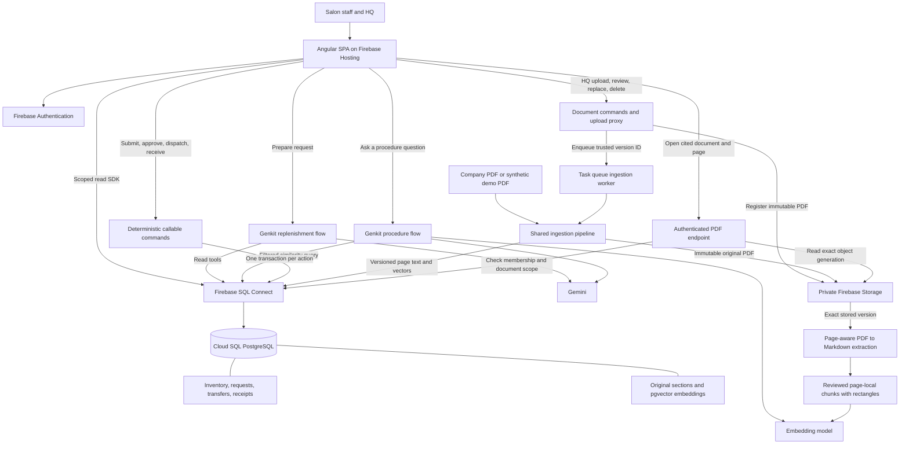
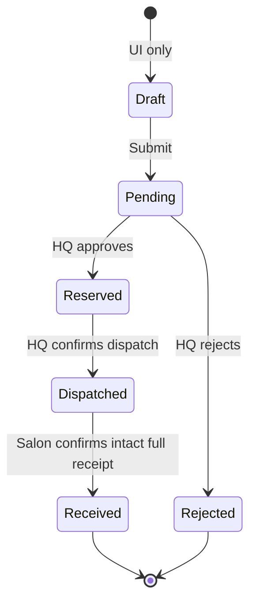
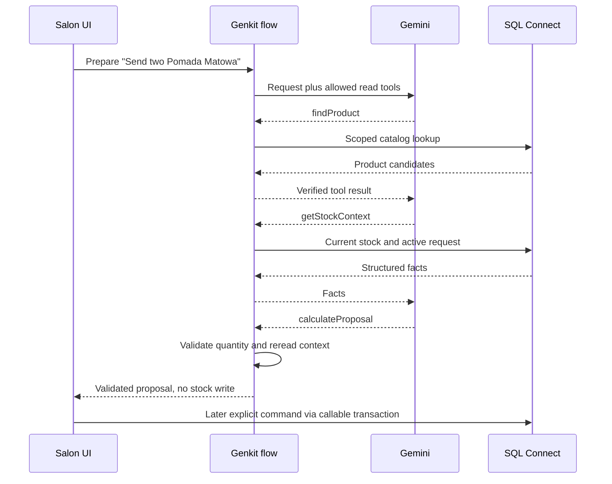
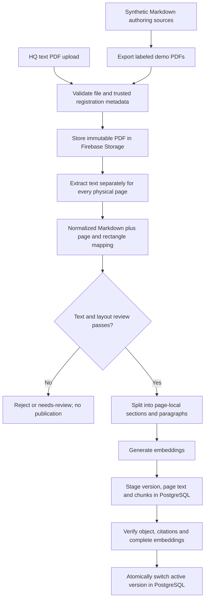
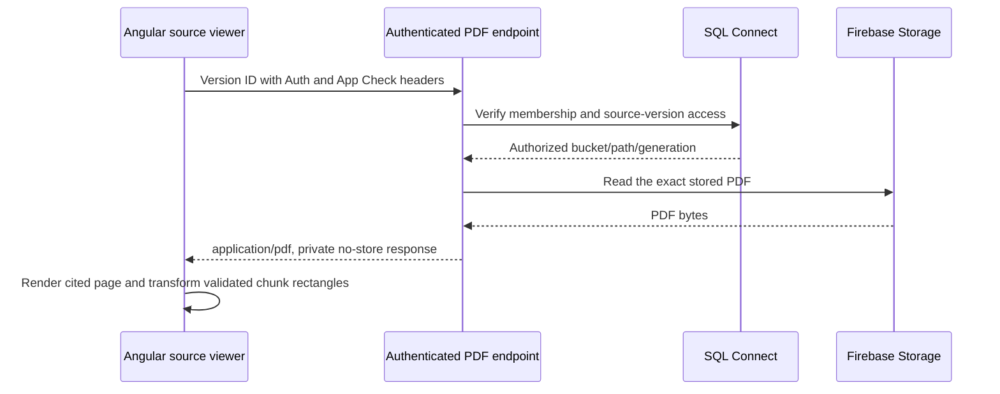

# BarberHQ — how the application will work

**Architecture proposal · updated 29 September 2026 · planning only**

The [master specification](../.claude/specs/barberhq-master.md) provides the project overview and document map. This document explains how to implement the [requirements](../.claude/specs/barberhq-replenishment-assistant.md). It does not claim that code, cloud infrastructure, model calls or database transactions have been tested. Product and salon names are real; stock and [procedure documents](synthetic-knowledge/README.md) are demo fixtures.

Implementation is split into [bounded phase specifications](implementation/README.md), with a separate [Firebase setup guide for the presenter](06-firebase-setup-guide.md).

The [approved design extensions](../.claude/specs/approved-design-extensions.md) own detailed multi-product draft, document-management and PDF geometry contracts. The [Claude Design handoff](../design_handoff_barberhq/SPEC.md) supplies visual/component references.

## 1. Design in one picture

Build one Angular SPA, one Cloud Functions codebase and one SQL Connect service backed by PostgreSQL, and a private Firebase Storage bucket for original PDFs. Use two AI flows with different responsibilities, plus explicit stock commands. pgvector stores the procedure embeddings in the same database as the business records. Firestore is not part of this proposed implementation; its alternative remains documented in the [research](01-research-and-recommendation.md).



All model calls run on the server. Neither AI flow can call a stock mutation. The browser does not connect directly to PostgreSQL.

## 2. Decisions and their reasons

| Decision | Reason |
|---|---|
| Angular client-side rendering and classic Firebase Hosting | Internal tool; no SEO or SSR requirement |
| Plain generated SQL Connect TypeScript SDK for reads | Reuse managed data operations without a custom REST API for every screen |
| Callable functions for commands | One place to validate user intent, identity and action requests |
| Native GraphQL operations by default | Typed operations; use transactions and conditional writes for stock changes |
| One database plus file storage | PostgreSQL owns stock, document metadata and retrieval; Firebase Storage holds original PDF bytes |
| Preload and HQ-managed text PDFs | One reviewed ingestion pipeline for initial fixtures and later document changes |
| Tool use for replenishment; retrieval-first pipeline for guidance | Flexible product interpretation where useful; mandatory evidence for procedure answers |
| Exact quantities and explicit confirmations | A measurable workflow whose numbers can be inspected |
| Read-only damaged-delivery scenario | Demonstrates RAG without inventing a claims/replacement system |
| No persistent chat history in the MVP | Each request/question is bounded; fewer records and less hidden conversational context |

SQL Connect exposes deployed operations and generated SDKs, supports transactional mutations, and provides vector similarity search. These capabilities support the design; the specific operations below still need compilation and concurrency testing. [Web SDK](https://firebase.google.com/docs/sql-connect/web-sdk), [mutations](https://firebase.google.com/docs/sql-connect/mutations-guide), [vector search](https://firebase.google.com/docs/sql-connect/solutions-vector-similarity-search).

## 3. Angular structure and state

The first increment is implemented in `web/`, with Angular/CLI 22.2.0 and Material/CDK 22.2.1 pinned. The [current Angular architecture](implementation/angular-architecture.md) owns the implemented directory layout and facade contracts. Use standalone feature components, signals for local state and computed presentation values, and Angular routing. Signals are appropriate for tracking UI state and derived values. [Angular signals](https://angular.dev/guide/signals)

| Route | Responsibility |
|---|---|
| `/salons/:salonId` | Stock list/low-stock marker, shared multi-product draft, active transfers |
| `/requests/:requestId` | Quantity, action buttons and status timeline |
| `/hq` | Pending approvals and reserved transfers ready for dispatch |
| `/procedures` | Question input, guidance and cited source sections |
| `/procedures?tab=documents` | Salon read-only library; HQ upload/review/replace/delete |
| `/procedures/sources/:versionId?page=N&chunk=CHUNK_ID` | Authorized original-PDF viewer opening the cited page and highlighting extracted rectangles; chunk optional for library browsing |

Use feature facades for functionality: the root `SessionFacade` owns Auth/membership; page-scoped facades own async loading/error state, derived selectors and commands. Components own form/presentation state and delegate actions. `data-access/` services isolate generated SDK calls and DTO mapping; `ui/` components only render inputs and emit intentions. The implemented inventory facade uses `resource`, `computed` and a scope-bound `linkedSignal` snapshot. Future stock, assistant and knowledge APIs follow the same boundaries. Use Angular Signal Forms; no global state framework is needed.

The server is authoritative. After a successful stock command, reload the request detail and affected inventory views. Do not optimistically subtract stock. On reconnect/window focus, refresh visible records. The HQ screen has a Refresh action; no realtime subscriptions are needed for the stage demo.

Route guards improve navigation but never constitute authorization. Use accessible labels, keyboard-operable dialogs, large numerical stock cards and live status announcements. Show source content as escaped text or sanitized Markdown; never render document HTML directly.

The proposal is an in-memory UI draft. `DRAFT` in the requirements is a presentation state; persisted requests begin at `PENDING_APPROVAL`. Refreshing before submission loses the draft, but does not create an orphan request. Preserve only pending submitted payloads/keys in session storage until reconciliation, as specified in the approved extensions. A shared list is submitted through independent per-product commands; its partial-success UI does not change backend request states. Low-stock is a display rule with one configured threshold (default 2), not automatic replenishment.

## 4. Interfaces and ownership

Names below describe application contracts, not pre-existing SDK methods. Define runtime schemas for callable inputs/outputs; generate database types from the actual connector schema.

### Read operations

`GetMyMembership`, `ListProducts`, `GetSalonInventory`, `ListActiveRequests`, `GetRequestDetail`, `ListHQQueue`, `GetSourceSection`, `ListKnowledgeDocuments` and HQ-only `GetKnowledgeReview` are deployed scoped operations. Paginate lists, initially 50 rows. Do not expose unrestricted inventory or document listing to authenticated users.

The browser uses Firebase identity directly for these operations. Server read tools should impersonate the verified caller where supported, preserving operation-level scope checks. The Admin SDK supports privileged access and impersonation; unrestricted use is not a replacement for authorization. [Admin SDK](https://firebase.google.com/docs/sql-connect/admin-sdk)

### AI entry points

| Callable | Input | Result |
|---|---|---|
| `prepareReplenishment` | `salonId`, `message`, optional explicitly selected clarification fields keyed by line ID | `PROPOSAL`, `NEEDS_CLARIFICATION` or `UNAVAILABLE` |
| `answerProcedureQuestion` | `question`, `answerLanguage` | `ANSWER`, `NEEDS_CLARIFICATION` or `INSUFFICIENT_EVIDENCE`, plus source sections |

A proposal returns `lines[]` with validated product ID/name, integer quantity 1–99, HQ availability, salon on-hand, inventory versions and line-level clarification/exclusions, plus real tool-event summaries. It reserves nothing and is not an approval token. The submit command validates the selected fields again, so manual entry follows the identical path.

Guidance returns an array of `{text, sourceSectionIds}` steps and sources containing document ID/version, section ID, title, extracted text, physical page number, document-version ID, chunk ID, geometry status/rectangles and synthetic flag. The server assembles source cards from actual retrieved records; the model cannot invent their title, URL, version or page. “Open PDF” uses the server-issued version/section identity, not an arbitrary storage URL supplied by the model.

Use Genkit flows behind Firebase callable functions, with verified Auth and App Check enforcement. Callable Genkit integration supports JSON and streaming; if implemented, stream only genuine tool status events and the validated final result. [Callable Genkit flows](https://firebase.google.com/docs/functions/oncallgenkit)

### Stock commands

| Command | Input beyond idempotency key | Authorized actor |
|---|---|---|
| `submitRequest` | salon/product IDs, integer quantity | Staff assigned to destination salon |
| `approveRequest` | request ID, expected request and HQ inventory versions | HQ |
| `rejectRequest` | request ID, expected request revision | HQ |
| `dispatchTransfer` | request ID, expected revision | HQ |
| `receiveTransfer` | request ID, expected revision, received quantity, `allIntact: true` | Staff assigned to destination salon |

Return `{actionReceiptId, requestId, state, revision, replayed}`. Actor, role, business and timestamps are never accepted from the client as facts. The receipt quantity must equal the stored dispatched quantity. A damage/missing-item response stops this happy path and opens guidance; it does not increment saleable stock.

### Document commands

HQ uses `createDocumentUpload`, authenticated binary `uploadKnowledgePdf`, `reviewAndPublishDocument`, `retryDocumentProcessing` and `deleteKnowledgeVersion`. The [approved extension contract](../.claude/specs/approved-design-extensions.md) defines their inputs, idempotency, review and conflict semantics. Upload is accepted before extraction; durable SQL processing status and a bounded task queue drive progress. Salon accounts have no document-write authority. Model tools have no document-management authority.

## 5. Data model and constraints

Store all business data in SQL Connect/PostgreSQL. Authentication credentials live in Firebase Auth. Source Markdown and the public product JSON remain in the repository; ingestion copies page-aware extracted procedure text into SQL. Original PDFs are stored privately in Firebase Storage. For the demo, the existing Markdown authors the synthetic PDFs. Extract those PDFs into separate normalized Markdown and page maps before chunking, so citations refer to the artifact the audience opens. Future real company PDFs enter at the extraction step without an authoring Markdown source.

All domain keys include or are checked against `businessId`; never allow a cross-business foreign reference. Use integer units, UTC server timestamps, and incrementing integer versions. Display times in Europe/Warsaw.

| Record | Key information and constraints |
|---|---|
| `Membership` / `SalonAccess` | User/business role and allowed locations; operator-maintained |
| `Location` / `Product` | Locations and six catalog products; published code stored as string; local demo ID separate |
| `Inventory` | Unique business/location/product; `onHand`, `reserved`, `version`; nonnegative and reserved ≤ onHand |
| `ReplenishmentRequest` | Salon/product/quantity; lifecycle state and revision; actor/time fields |
| `ActiveRequest` | Unique business/salon/product slot referencing the current open request |
| `Transfer` | Unique request reference; warehouse/destination/product/quantity; dispatch and receipt quantities/times |
| `StockMovement` | Unique transfer/movement-type; `DISPATCH` or `RECEIPT`, quantity, actor/time |
| `ActionReceipt` | Unique business/actor/idempotency-key and unique request/action; payload hash and committed result |
| `KnowledgeDocument` | Stable business/document ID; pointer to active version and publication revision |
| `KnowledgeVersion` | Unique document/version; title, status, language, synthetic flag, bucket/object path and generation, PDF SHA-256, content type, byte size, page count, parser version, extraction hash, ingestion state, processing error/attempt, revokedAt, revision and reviewedBy/At/coverage |
| `KnowledgePage` | Unique version/physical-page number; extracted page text, optional printed page label, extraction quality/review state, PDF view box, user unit and intrinsic rotation |
| `KnowledgeChunk` | Unique version/page/chunk ordinal; section ID/title, extracted text and page-text character offsets, chunk rectangles/geometry status, vector, embedding model/dimension/hash |
| `KnowledgeOperation` | Unique business/actor/idempotency key; document/version, action, payload hash, status/result for document-command retry safety |
| `AIUsageWindow` | Unique user/hour; atomically incremented admitted-request count for the demo quota |

`ActiveRequest` is a small uniqueness guard, not a queue: insert it with submission, remove it only on rejection or completed receipt, in the same transaction. A competing submission gets the existing request instead of a second open workflow. This avoids relying on a client-side “does a request exist?” check.

The request is the canonical lifecycle record. If transfer state is materialized for convenience, change it in the same transaction and enforce consistency. `inTransit` is derived from dispatched transfers whose receipt is incomplete; do not maintain another stock counter for it. StockMovement is an audit record, not an event-sourcing architecture.

Add ordinary indexes for inventory keys, queue state/time, request salon/time and chunk version IDs. The tiny corpus can use exact vector search; approximate indexes and search infrastructure are unnecessary until measurement justifies them. Do not implement unverified schema syntax from this table; inspect generated types and compile operations during implementation.

## 6. Stock transactions — exact behavior



| Transition | HQ on hand | HQ reserved | In transit | Legnicka on hand |
|---|---:|---:|---:|---:|
| Initial / submitted | 18 | 0 | 0 | 2 |
| Approved | 18 | 2 | 0 | 2 |
| Dispatched | 16 | 0 | 2 | 2 |
| Received | 16 | 0 | 0 | 4 |

### Transaction algorithm

Every command executes one deployed transactional mutation. Recheck membership and entity business scope within the mutation, in addition to callable validation. Browser-visible operations use Auth-derived identity. Server-only command mutations use `NO_ACCESS`; the callable supplies actor identity from its verified token, never from the browser payload, and the mutation validates membership for that actor. Client traffic must not be able to invoke these mutations directly. [SQL Connect authorization](https://firebase.google.com/docs/sql-connect/authorization-and-security)

1. Look up the idempotency receipt within the caller's permitted scope. Same key and payload means return the stored result; different payload means `IDEMPOTENCY_CONFLICT`.
2. Read the stored request, inventory and current versions; validate role, business, state and quantities.
3. Update the lifecycle row with a predicate matching its ID, expected state and revision. Increment revision; require exactly one affected row.
4. Update inventory using an expected-version predicate; use validated arithmetic. Require exactly one affected row for every affected inventory record.
5. Insert any transfer/movement records and the action receipt; update/remove the active-request slot as required.
6. Commit everything together. Any failed check rolls back all writes.

**Approve:** require available units ≥ quantity; increase reserved. **Dispatch:** require the transfer's reservation still exists; decrease both onHand and reserved, create the unique dispatch movement. **Receive:** require dispatched state and full intact quantity; increase destination onHand, create the unique receipt movement and close the active slot. **Reject:** pending only, release the active slot without touching stock.

Use compare-and-set updates: compute the new value from a read version, then update only if that version still matches. Do not rely on separate read/check/write calls without conditional predicates. A racing action fails and is re-reviewed. The implementation gate must prove the operation's behavior against the deployed database, not merely a mocked repository.

Two concurrent calls with the same key may race before either receipt exists. Unique receipts and transactional state guards allow one commit; the losing caller reads the committed receipt and returns it only when action/payload match. A new key for an already completed identical action returns its existing semantic receipt; it never creates another movement. Conflicting quantities/actions fail. Recheck authorization even when replaying a receipt.

Prefer generated GraphQL filtered updates with affected-row checks. If the compiler cannot express the required guard, use a narrowly parameterized Native SQL operation only for that atomic command after reviewing its generated contract. This is a specific feasibility fallback, not permission to expose arbitrary SQL to the model.

## 7. Replenishment agent execution



The last arrow abbreviates the separate callable command path shown in the system diagram.

Use one allowlist: `findProduct`, `getStockContext`, `calculateProposal`. Product lookup begins with exact code/name/curated aliases; Gemini can interpret wording but must return a real catalog candidate. Preserve accents in display names; normalization is only for matching. Do not silently treat all matte products as synonyms.

Tools receive caller scope through server context, not model arguments. Their input schemas restrict identifiers and integer quantities 1–99. Each read tool supports bounded arrays (at most the six active demo products) so one sentence can produce multiple validated lines within the existing tool budget. A final proposal is rebuilt from validated tool results; model prose cannot change its numbers. Follow-up clarification starts another bounded call with explicitly selected fields, not an unbounded conversation history.

Genkit supports model-selected tool calls and a maximum-turn setting. This design adds its own call/time/output budgets: five model turns, eight tool executions, 25-second flow deadline, 2,000 input characters, and ten admitted requests/user/hour across both AI endpoints. Reject before model invocation when the quota is exhausted. Timeouts stop further work where supported; a provider call already underway may still incur cost. [Genkit tool calling](https://genkit.dev/docs/js/tool-calling/)

## 8. PDF ingestion — preload and HQ document changes

The demo supports **operator-preloaded and HQ-uploaded text-based PDFs** through one pipeline. HQ manages uploads and human review in the document library. Storage remains private; authenticated HTTP uploads are registered in SQL and enqueue a bounded ingestion worker, not an automatic Storage trigger. The handoff contains a sample PDF, but canonical corpus export, cloud upload and ingestion have not been performed.



### 8.1 Original file and metadata

Upload each approved input to an immutable object path, for example:

```text
knowledge/not-bad-stuff-demo/DAM-001/v1/<pdf-sha256>.pdf
```

Persist the bucket, full path, object generation and SHA-256 in `KnowledgeVersion`. Reuse an identical existing object only after verifying its identity; never overwrite a published version. A changed PDF requires a new document version even if its title is unchanged.

An operator manifest supplies initial document metadata; HQ imports use server-validated registration records. The server derives business scope and permission, assigns immutable version identity and validates title, language, source type, synthetic flag and intended publication status. Do not infer authorization or publication status from PDF text or embedded metadata. The synthetic exports must retain a visible demo label on every page. The public product-guide compilation must instead carry an unofficial demo-compilation label and dated source URLs; it does not establish internal policy. Exclude READMEs, evaluation cases and presentation notes from the input allowlist.

### 8.2 Supported extraction and quality gate

Initial proposed ingestion limits: **10 MiB and 30 pages per document**, enforced before expensive processing. These are demo limits, not Firebase limits. Validate the actual PDF format, not just its extension. Reject encrypted/password-protected, malformed or oversized inputs with a recorded reason. Use the same extraction core in the operator task and deployed task queue worker, with bounded timeout and pinned parser dependencies; no untrusted PDF JavaScript or embedded actions are executed.

Use page-aware text extraction (for example, Python `pdfplumber` in the operator task). Retain `physicalPageNumber` as a one-based PDF page index, independent of printed page labels. Store the extracted text per page before chunking. Produce normalized Markdown plus a machine-readable page/geometry map; retain one-based physical page numbers, text offsets and span coordinates in that map. Operator runs keep local derived artifacts; deployed processing persists authoritative text, geometry and provenance in SQL, using temporary files only as scratch space. Markdown helps inspect and split headings and paragraphs, but the stored PDF remains the cited source. Keep original authoring Markdown separate from this PDF-derived Markdown. Normalize whitespace conservatively; removal of repeated headers/footers must preserve provenance and be checked against rendered pages.

Image-only/scanned pages require OCR and are **unsupported in phase one**. Mixed scanned/text documents, uncertain reading order, multi-column layouts, essential tables and diagram-dependent instructions go to `NEEDS_REVIEW`; do not publish a silently incomplete extraction. Blank cover/separator pages may be excluded only after operator review. The preloaded demo uses simple text-and-heading PDFs. OCR and layout-aware table/diagram processing are separate future work, not a fallback that guesses missing text.

For each demo PDF, render and visually compare every page with extracted text before publication. Check that steps, negations, headings and order survived extraction. Readable text extraction alone does not prove complete content.

### 8.3 Chunking and embedding

Split by heading/paragraph **within each page**; a section crossing pages produces separate chunks sharing a logical section ID. Keep short sections whole; initially cap longer chunks near 350 tokens and overlap only within the same page when a split is needed. Record page number, offsets into that page's normalized text and rectangles mapped from extraction spans. Store the page view box/user unit/intrinsic rotation and rectangles in unrotated PDF user space so the viewer can use its viewport transform. Missing geometry is explicit; rehearsed citations require verified mappings. This makes each citation directly traceable; semantic grouping does not erase page boundaries.

Embed `document title + section heading + chunk text`. Store the original extracted chunk text for Gemini and source cards. For short synthetic documents, no summarization or separate model-based extraction is needed. The pipeline must not read the original authoring Markdown as a shortcut: the PDF is the indexed source in the stage demo.

Use one pinned embedding model/configuration for documents and queries, with matched document/query modes where offered. Provisionally select 768 dimensions only after confirming support from the chosen model. Record model ID, dimension, parser version and hashes. Model or parser changes require a new ingestion artifact/version rather than altering text or vectors behind existing citations.

### 8.4 Publication and failure recovery

Track ingestion as `STAGED → EXTRACTED → REVIEWED → EMBEDDED → READY`, or `FAILED` / `NEEDS_REVIEW`. These are ingestion states; current/retired publication is a separate property.

Storage and PostgreSQL do not share a transaction. Upload the immutable original first, then stage its SQL metadata/pages/chunks. Verify the object's generation/hash, reviewed page coverage, chunk counts and vector dimensions before atomically switching `activeVersionId` in PostgreSQL with an expected document revision and non-revoked version guard. Partial writes are never eligible for retrieval. A failed run leaves the previous active version untouched.

Make ingestion retryable by document/version/PDF hash. A repeated identical run reuses verified staged work; the same document/version with different bytes is a conflict. Unreferenced staged files can be cleaned up by a later operator task; ordinary UI deletion retains immutable bytes/audit but revokes access to the selected version. Clear its active pointer if current; never fall back to old policy automatically. A later physical-cleanup policy is outside the demo. Retain DAM-001 v0 as a retired filtering fixture and never point the active document at it.

HQ upload stops at extracted text for explicit page-by-page review. Review approval queues embedding/publication; failed extraction or processing keeps the previous active document usable. Queue retries reuse the same version/hash and cannot bypass review or resurrect revoked versions. The library can resume registered jobs whose queue submission failed. [Task queue functions](https://firebase.google.com/docs/functions/task-functions) provide the selected asynchronous execution mechanism; verify runtime/parser compatibility and retry limits in phase 3.

Embeddings are generated explicitly by the operator/server code and supplied to SQL Connect. Its similarity queries accept supplied vectors and row filters; we use that single path consistently. [SQL Connect vector search](https://firebase.google.com/docs/sql-connect/solutions-vector-similarity-search)

### 8.5 Opening the original PDF securely

A source card shows, for example, **“Damaged products in a salon delivery · v1 · PDF page N”**, with the actual page supplied by extraction, never a guessed page number.



Use an HTTP function `getSourcePdf(versionId)` to stream the authorized original. Verify the Firebase ID token and App Check token explicitly for this HTTP endpoint; permit only the app's configured origins. The server resolves the path from SQL, never from client input, and checks both business membership and document-level scope. Permit published historical versions to authorized staff with a “superseded” label; scoped HQ can also preview staged files for review. Deny revoked versions regardless of historic citations.

For the first small-file demo, Angular fetches the complete bounded file and passes its bytes to a PDF.js-based viewer supporting page and chunk parameters. GetSourceSection validates that the chunk belongs to the requested version and returns authoritative page/geometry; the model supplies no coordinates. Render chunk rectangles through the same viewport transform as the page, including zoom/rotation. Missing geometry displays page+excerpt with an explicit unavailable-highlight state. Do not rely solely on browser `#page=` behavior for the stage proof. If preview fails, offer an authorized download and display the physical page number. Revoke temporary browser object URLs when closing the viewer.

Deny direct client reads/writes in Storage rules; use scoped server/operator IAM for the proxy and ingestion. Do not persist public download tokens or long-lived bearer URLs in source cards. Storage client rules do not automatically enforce SQL membership, and server access must perform its own checks. This proxy keeps the existing SQL authorization model authoritative. [Cloud Storage security](https://firebase.google.com/docs/storage/security)

## 9. RAG retrieval — when staff ask

1. Authenticate and resolve the business; validate the question. Default corpus language is English. Polish answers may use the English corpus only after cross-language evaluation; do not filter to nonexistent Polish documents.
2. Read active document version IDs accessible to the caller. The initial corpus has four active documents (three procedures and one public product guide); HQ publication/deletion changes this set.
3. Embed the question with the configured query embedding model.
4. Query chunks with business and eligible-version filters **inside the similarity query**, using cosine distance and a maximum of three results. Do not retrieve across businesses and filter afterward.
5. Apply a relevance threshold calibrated on the evaluation cases. No acceptable evidence returns `INSUFFICIENT_EVIDENCE` without a procedural answer.
6. Give Gemini the question and retrieved section text, each labeled by source ID. Ask for a structured answer whose steps reference those IDs and an explicit statement of any information missing from the sources.
7. Validate schema and citation membership. One bounded targeted retrieval is allowed if a required section is missing, replacing the context with at most three relevant sections. Invalid output after the allowed attempt returns a controlled failure.
8. Recheck that cited versions are still current and non-revoked before delivering the answer. If publication changed meanwhile, retry once within the budget or ask the user to retry.
9. Return answer and server-built source cards with the synthetic label, PDF version, chunk identity, physical page and extraction geometry. Provide an authenticated “Open PDF” action. No inventory functions are in this execution path.

The guidance flow always retrieves first; Gemini does not decide whether evidence is optional. The model explains the instructions; it cannot turn a document sentence into a command. The source viewer shows the extracted section and opens that same immutable PDF version at its cited page with the extracted passage highlighted, labeling it if later superseded and denying access if revoked.

A citation ID check cannot prove semantic truth. Human-reviewed expected answers and negative tests are required, especially for unsupported deadlines, disinfection questions and replacement promises. Text containing instructions to bypass permissions is treated as untrusted source material. No online web search is used to fill gaps in the company's procedures.

## 10. Failure behavior

| Result | UI response | Persistence |
|---|---|---|
| `NEEDS_CLARIFICATION` | Product/quantity choices | No stock writes |
| `INSUFFICIENT_STOCK` | Explain shortage; do not approve | No partial commit |
| `STALE_STATE` | Reload detail and require review | Failed transaction rolled back |
| `ALREADY_ACTIVE` | Link to existing request | One active request |
| `INVALID_TRANSITION` | Show current state | No mutation |
| `IDEMPOTENCY_CONFLICT` | Reload; do not create a replacement key automatically | No second action |
| `INSUFFICIENT_EVIDENCE` | State what the sources do not cover | No business mutation |
| `FORBIDDEN` / unauthenticated | Sign-in or access message without revealing foreign records | No business mutation |
| AI timeout/quota | Manual replenishment or explicit question retry | No stock change from AI |
| Unknown result after command timeout | Retry the same action/key or fetch its receipt | Never assume failure means no commit |

The guidance scenario uses Zakładowa and a fictional damaged delivery independent of the completed Legnicka transfer. If an actual demo transfer has a damaged receipt, leave it dispatched/unresolved and show guidance. A later real product would need a separate discrepancy-resolution workflow; this design does not quietly invent one.

## 11. Deployment and project organization

Suggested future layout; none of these implementation folders are created by this document:

```text
web/                         Angular SPA and generated read SDK
functions/src/
  ai/                        Two Genkit flows, schemas and prompts
  commands/                  Submit, approve, reject, dispatch, receive
  knowledge/                 Document commands, upload proxy and shared ingestion worker
  domain/                    Quantity validation and shared contracts
  data/                      Narrow generated-operation adapters
  auth/                      Caller membership/scope checks
  generated/                 SQL Connect Admin SDK
dataconnect/                Schema and browser/server connectors
scripts/                     Seed/reset, PDF export/extraction, ingestion and evaluation
storage.rules                Deny direct client access; originals served through authorized proxy
docs/                       Existing design, catalog and source Markdown
```

Use one repository without Nx or a shared-package framework for this small demo. Generate SDKs from deployed connector operations; keep runtime contracts small and avoid importing server dependencies into Angular.

Deploy to an isolated billing-enabled Firebase demo project. Pre-create salon and HQ Auth users; membership is seeded by an operator. Select compatible EU locations for functions, SQL, the Storage bucket and model access before provisioning. Prefer service-account/IAM access to the model provider; if a selected provider needs an API key, keep it in Secret Manager. Never put model credentials in the Angular bundle.

Deployment order follows the [phase index](implementation/README.md): prepare local assets and provision/configure resources → compile/deploy schema and connectors → generate matching SDKs → deploy private Storage rules, scoped IAM and backend functions → seed business data and ingest reviewed PDFs → build/deploy the manual Angular workflow → add AI flows → rehearse. Small isolated backend test fixtures precede the complete seed when needed for phase-02 proof. Do not provision cloud resources during the 20-minute presentation. Seeding uses an explicit demo-project allowlist, not a public reset endpoint.

Build local deterministic tests with emulators/mocked model output, but run final integration and concurrency tests against the demo deployment. Embedding/model calls and region compatibility require real-service verification. Log action receipts, run IDs, durations, tool outcomes, source IDs and model/config versions; keep raw questions and document text out of routine logs. Budget alerts do not enforce a cap; quota counters and a server AI-disable flag bound use. Keep a local labeled recording for venue failure.

### Confirmed frontend release process

The [Firebase Hosting deployment specification](../.claude/specs/firebase-hosting-deployment.md) defines the cross-phase release contract. Phase 4 implements the production browser build, validated public configuration, explicit Hosting site/output, SPA fallback and initial no-cache headers. Phase 7 deploys a preview, checks exact origins and deep links, promotes that tested Hosting version to live and demonstrates frontend rollback. Preview/live share backend data. Hosting release/rollback does not deploy the separate backend, undo migrations or reset inventory.

Public settings are compiled into Angular; backend secrets stay with functions/provider configuration. No SSR or App Hosting environment-variable setup is required. The implementation produces a verified deployment runbook and records preview/live URLs and version IDs.

## 12. Build order and proof gates

| Phase | Deliverable | Stop condition |
|---|---|---|
| 0. Owner setup | Firebase resource/account configuration | Required resource settings available |
| 1. Data and PDFs | Six-product fixtures and five reviewed PDFs | Labels, provenance, hashes and extraction verified |
| 2. Backend | Scoped GraphQL and guarded stock commands | Concurrent approval and duplicate receipt cannot corrupt stock |
| 3. Seed and ingest | SQL fixtures, shared worker, private originals, text/geometry/vectors | Reviewed retryable publication; retired/foreign/revoked content excluded |
| 4. Angular | Manual batch/HQ/receipt, document library and highlighted viewer | Exact 18 → 16 and 2 → 4 without Gemini; independent batch retries and document permissions pass |
| 5. Replenishment agent | Multi-product interpretation and bounded array read tools | Valid request and ambiguity cases pass; AI cannot mutate stock |
| 6. Procedure RAG | Filtered retrieval and cited answers | Corpus positive/negative cases and page citations pass |
| 7. Stage readiness | Deployment, reset and timed rehearsal | Both scenarios complete within six minutes repeatedly |

Check every state-table row; verify total stock including in-transit units remains 20. Repeat commands with the same and different keys, race requests, and try unauthorized actors. Verify retired/foreign documents never enter model context; evaluate the original question paraphrases, unsupported questions and injected source instructions.

Also verify malformed/encrypted/scanned and mixed-content PDFs fail safely; unsupported layout is held for review; unauthorized and revoked PDF access is denied; retries do not republish conflicting bytes; source citations highlight correct regions; HQ upload/replace/delete and concurrent publication preserve access rules; a broken extraction leaves the prior version active.

Four implementation decisions remain deliberately gated: exact compatible package/model versions; deployed region support; the compiled conditional-write expression; and the calibrated retrieval threshold. None changes the agreed business scope. If Firestore Vector becomes mandatory, revise the storage decision explicitly before building; do not add it silently alongside this design.
