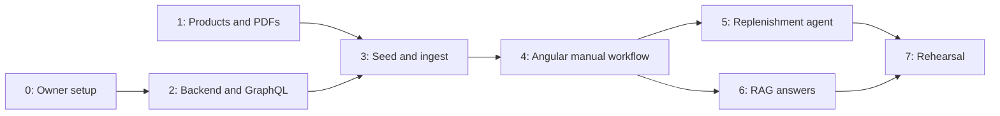

# Implementation phases

**Updated 29 September 2026 · specifications only. No phase has been implemented.**

## Approved delivery approach — implementation plans under review

The user approved five working increments: login/live inventory, manual replenishment, PDF knowledge/library, the two AI flows, and final rehearsal. The [incremental delivery design](../superpowers/specs/2026-09-29-barberhq-delivery-design.md) consolidates the approved sections and was accepted for planning through the explicit writing-plans request.

Use that design for execution sequencing. The original phases below remain requirement packages and coverage checkpoints, not a mandate to finish complete technical layers in numeric order. In particular, structured seed/memberships and the first Hosting release move into increment 1; document ingestion does not block the first inventory screen. No original acceptance criterion is removed.

The [execution index and seven detailed plans](../superpowers/plans/2026-09-29-barberhq-execution-index.md) are written and awaiting review and execution-method selection. Do not use the legacy whole-phase prompt below to start implementation under the new approach. Future reports use `handoffs/increment-<id>.md` and map evidence back to original phase criteria.

Start with the [master project specification](../../.claude/specs/barberhq-master.md) to understand how the pieces fit together. Build BarberHQ in small, verifiable increments. Each agent receives the shared contract, one phase specification and the completed prerequisite handoff reports. The full architecture is a reference for named sections, not mandatory context for every task.

## Original requirement packages and ownership

| Phase | Owner | Deliverable | Requires |
|---|---|---|---|
| 0 | Presenter | [Firebase setup guide](../06-firebase-setup-guide.md): project, Auth, Storage, SQL Connect and model configuration | Nothing; can run alongside phase 1 |
| 1 | Data preparation agent | [Products, synthetic procedures and PDFs](../../.claude/specs/phase-01-data-and-pdfs.md) | Existing catalog and Markdown sources |
| 2 | Backend agent | [Firebase, GraphQL, stock and document contracts](../../.claude/specs/phase-02-firebase-graphql-backend.md) | Phase 0 for cloud validation; local work can start earlier |
| 3 | Ingestion agent | [Seed PostgreSQL and shared PDF ingestion worker](../../.claude/specs/phase-03-seed-and-ingest.md) | 1, 2 and provisioned resources |
| 4 | Angular agent | [Manual batch workflow, document library and highlighted PDF viewer](../../.claude/specs/phase-04-angular-app.md) | 2 and 3; local shell can start with published contracts |
| 5 | Agentic workflow agent | [Replenishment assistant](../../.claude/specs/phase-05-replenishment-agent.md) | 4 |
| 6 | RAG agent | [Procedure retrieval and grounded answers](../../.claude/specs/phase-06-rag.md) | 3 and 4; independent of 5 |
| 7 | Verification agent | [Deployment and presentation rehearsal](../../.claude/specs/phase-07-demo-readiness.md) | 5 and 6 |

The following diagram records the original whole-phase dependency model; the new delivery design splits these packages into smaller working increments.

## Deployment across phases

**Classic Firebase Hosting is confirmed.** The [deployment specification](../../.claude/specs/firebase-hosting-deployment.md) is shared by phase 4 (build/public configuration, Hosting routes and headers) and phase 7 (preview, live release and rollback). Backend deployment remains separate. This adds no extra phase.

## Approved design scope across phases

The [approved extensions](../../.claude/specs/approved-design-extensions.md) map the intentional Claude Design additions into the existing phases: phase 2 supplies document APIs/guards, phase 3 reusable ingestion and geometry, phase 4 manual batch/library/highlight UI, phase 5 multi-product AI and phase 6 source identity/revocation checks. Phase 7 verifies the integrated behavior; there is no extra phase or new stock lifecycle. The [handoff SPEC](../../design_handoff_barberhq/SPEC.md) owns visual tokens and component mapping.

## Small context packs

After the master overview, every phase reads [shared contracts](shared-contracts.md), its own specification, relevant sections of the approved extensions and only the prerequisite reports it needs. Each specification lists additional source documents or architecture sections. Do not load slide notes, previous conversations or every specification by default.

Legacy whole-phase handoff prompt (reference only; the reviewed increment plans replace it for execution):

> Implement phase NN from `.claude/specs/phase-NN-….md`. Read `.claude/specs/barberhq-master.md`, then `docs/implementation/shared-contracts.md`, `.claude/specs/approved-design-extensions.md` and the required prerequisite reports. Stay within this phase. Record validation evidence and outputs in `docs/implementation/handoffs/phase-NN.md`; distinguish local checks from deployed checks. If a prerequisite is missing, complete independent work and report the exact blocker. Do not implement later phases.

Every completion report must contain: status (`READY` or `BLOCKED`), implemented scope, actual file paths and pinned versions, public configuration requirements, commands/checks and their outcomes, output counts/hashes where relevant, unresolved limitations, and what the next agent should read. Never include credentials or claim an unrun check passed. `READY` means that phase's acceptance criteria passed, including cloud checks where required.

## Checkpoints

- After 1: real product facts and visibly synthetic PDFs are reviewable locally.
- After 3: SQL contains fixtures and searchable chunks with geometry; Storage contains originals; reusable HQ ingestion/review/publication works.
- After 4: the 2-unit stock movement, manual multi-product draft, HQ document library and highlighted viewer work without model-driven stock actions.
- After 5: natural language prepares one or several validated draft lines.
- After 6: a damaged-delivery question returns supported guidance and opens its PDF page with the supporting region highlighted.
- After 7: both scenarios fit the existing 20-minute presentation.

These phase specs refine the [application requirements](../../.claude/specs/barberhq-replenishment-assistant.md) and [architecture](../05-architecture-how.md). If a concrete feasibility check requires a contract change, record it and update dependent specs before continuing. Do not silently weaken the stock or authorization guarantees.
