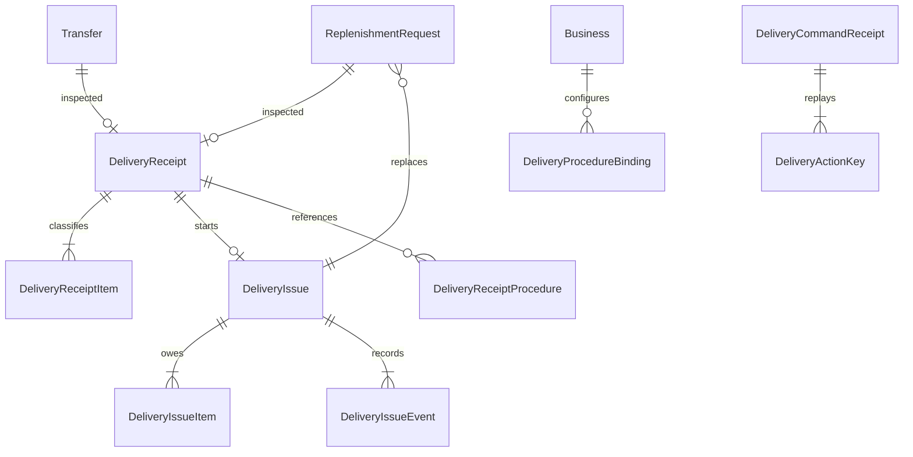

# Delivery schema and command boundaries

Task2, 2026-10-25. Local schema only; no cloud migration or publication.

## Uniqueness and ownership

| Table | Primary/unique keys | Scope |
| --- | --- | --- |
| DeliveryReceipt | id; unique request; unique transfer | business + salon; immutable inspection, origin RECORDED/LEGACY |
| DeliveryReceiptItem | receipt + product | Physical SQL name `delivery_item`; good/damaged/missing are distinct facts |
| DeliveryIssue | id; unique rootReceipt | business + salon, immutable initial entitlement, status/revision, nullable active child |
| DeliveryIssueItem | issue + product | initialAffected and replacementAccepted; server derives outstanding |
| DeliveryIssueEvent | id; unique issue + revision | actor/time/type/status/request/note/quantity snapshot |
| DeliveryProcedureBinding | business + kind | nullable document disables mapping without resetting revision |
| DeliveryReceiptProcedure | receipt + kind | historical version/chunk; never grants PDF access |
| DeliveryCommandReceipt | id | business/actor/type/target/hash/immutable result |
| DeliveryActionKey | business + actor + idempotencyKey | immutable command result/hash, separate from old stock action uniqueness |

RequestState adds `RECEIVED_WITH_ISSUE` at the end of the enum, preserving the order of existing values. `ReplenishmentRequest.replacementIssue` is nullable and links every replacement directly to its root issue.

## Reads and authorization

Browser GetDeliveryReceipt/GetDeliveryIssue first require a membership, select only that membership's business, require exactly one requested record, then require HQ or explicit access to its salon. ListDeliveryIssues applies the same business boundary and requires HQ for all-salon reads. Per-salon reads require HQ or SalonAccess. Limits are1–50, offsets nonnegative; issue events and replacements are separately paginated. Stable ordering uses createdAt+id or issue revision+id. Procedure binding settings are HQ-only.

Browser writes to delivery tables are unavailable. Server connector operations are NO_ACCESS; callable code must verify the authenticated actor and repeat guards in mutations. An admin-only historical receipt insert is a backfill primitive, not a callable receipt API.

## Compiler regression found and fixed

The initial deep receipt projection failed for both authorized HQ and salon while ordinary GetRequestDetail worked. A direct read-only diagnostic of generated SELECT identified PostgreSQL42703: a nested product lookup reused its parent alias after PostgreSQL truncated both identifiers to63 bytes. The emulator surfaced the SQL error with a misleading FORBIDDEN suffix.

The new receipt-item table therefore uses the shorter physical name `delivery_item`. GraphQL/DTO names stay DeliveryReceiptItem. This removes the alias collision without weakening the original business/salon guards. Both authorized roles, foreign/unassigned roles, invalid pagination, and denied browser writes passed against the real local Auth/SQL emulators (5/5). This is a regression covered by those actual deep reads.

SDK regeneration now requires an explicit `--project`, e.g. `npm run generate:sdk -- --project demo-barberhq`. It has no production default and retains enum postprocessing. Cloud browser SDK preparation remains separate.
